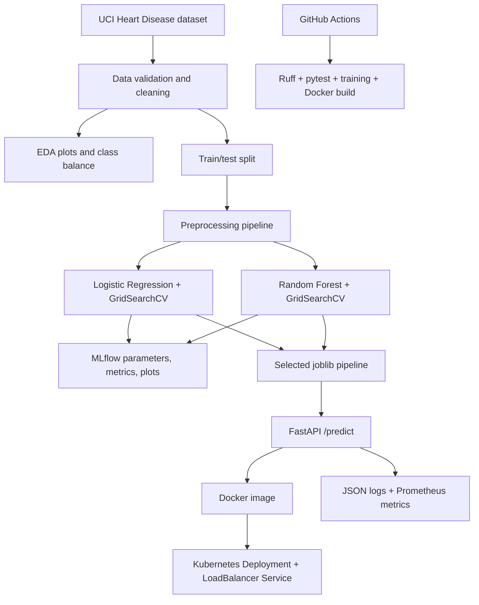

# Architecture

The CI workflow verifies quality and creates artifacts; the Kubernetes deployment is intentionally a manual release step so an image registry and cluster credentials are not assumed.
